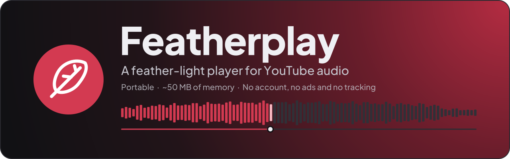
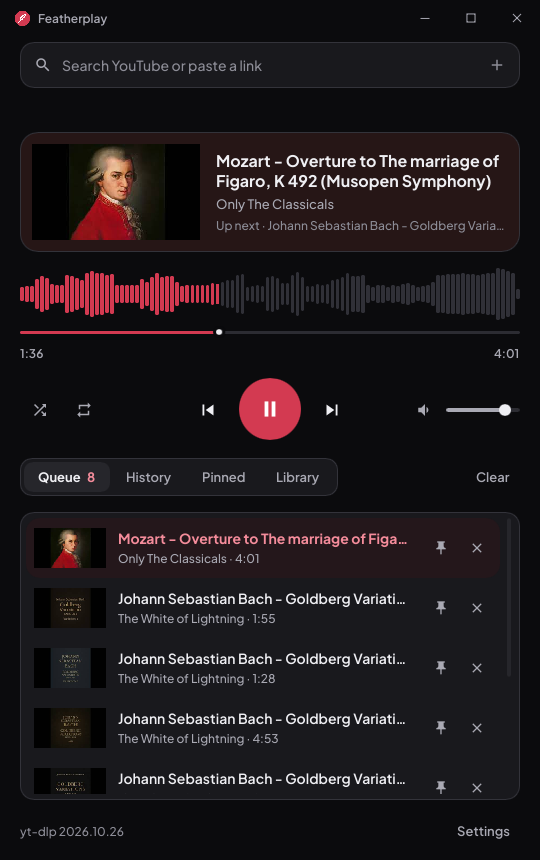

<p align="center">
  
</p>

<p align="center">
  <a href="https://github.com/Hamza-ELAKLY/featherplay/releases/latest"></a>
  <a href="https://github.com/Hamza-ELAKLY/featherplay/actions/workflows/ci.yml"></a>
  
  <a href="LICENSE"></a>
</p>

Featherplay is a lightweight desktop player for the audio of YouTube videos, playlists
and Mixes. It runs as a single portable executable, uses about 50 MB of memory while
playing, and has no ads or telemetry. Signing in is optional, view-only, and through Google's own page.

Website: [hamza-elakly.github.io/featherplay](https://hamza-elakly.github.io/featherplay/)

<p align="center">
  
</p>

## Features

- Play a YouTube video, playlist or Mix from a pasted link, or search YouTube (results
  keep loading as you scroll)
- Play next, Start radio (a song's YouTube Mix) and more from a right-click menu
- A queue with repeat, shuffle and drag-to-reorder; pinned favourites and a history
- Optional sign-in with Google (view-only) for a Library tab: your liked videos and
  playlists, private ones included (see [Signing in](#signing-in))
- A waveform seek bar measured from the track itself
- Smooth playback: pause, resume and track changes fade in and out instead of cutting
- Keeps playing from the system tray; media keys and the Windows media overlay
- Picks up where it left off: queue, position and settings are kept between runs
- Light and dark themes, or follow Windows
- Updates itself from GitHub releases, verified by SHA-256 before installing
- Portable: nothing to install, everything stays in its own folder

## Installation

### Windows

Requires Windows 10 or 11, 64-bit.

1. Download `Featherplay-<version>-windows-x64.zip` from the
   [latest release](https://github.com/Hamza-ELAKLY/featherplay/releases/latest).
2. Unzip it anywhere and run `featherplay.exe`.

yt-dlp is included in the folder and kept up to date by the app.

The executable isn't code-signed yet (signing is under way; see the
[code signing policy](CODE_SIGNING.md)), so on first run Windows may show *"Windows
protected your PC"*: choose **More info → Run anyway**.

To check a download against the release's `SHA256SUMS.txt`:

```powershell
Get-FileHash .\Featherplay-<version>-windows-x64.zip -Algorithm SHA256
```

### Linux

> [!NOTE]
> Linux support is under way but not finished: there is no Linux download yet, and it
> isn't fully tested. It can be built from source (see
> [Building from source → Linux](#linux-1)).

### macOS

Not supported yet. macOS support is planned for a later release.

## Usage

| Action | How |
|---|---|
| Play a link now | Paste it in the search box, press **Enter**. It plays next; the queue continues after it. |
| Add a link to the queue | **Shift+Enter**, or the **+** button |
| Search | Type words, press **Enter**; results are in the **Results** tab |
| Reorder | Drag a track in the queue or the pinned list |
| Pin a favourite | The pin button on a track; pins are in the **Pinned** tab |
| More actions | Right-click a track or playlist: Play next, Start radio, Copy link, Open on YouTube… |
| Your library | Sign in from the **Library** tab: liked videos and playlists; pin a playlist to keep it in **Pinned** |
| Seek | Click or drag on the waveform |

| Key | Action |
|---|---|
| **Space** | Play / pause |
| **← / →** | Back / forward 5 seconds |
| **Ctrl+← / Ctrl+→** | Previous / next track |
| **↑ / ↓** | Volume |
| **M** | Mute |
| **Ctrl+L** | Focus the search box |

Closing the window keeps playback running in the tray; quit from the tray icon's menu.
Data (queue, pins, history, settings) is stored in `data\` next to the executable, or in
`%APPDATA%\featherplay` when that folder isn't writable. Deleting the folder uninstalls it.

### Signing in

Signing in is optional and only needed for the Library tab. It goes through Google's own
page in your browser, asks for view-only access to your YouTube account, and the sign-in
is kept encrypted on your PC. Sign out in Settings, or remove
Featherplay from your Google account's third-party connections. See the
[privacy policy](PRIVACY.md).

> [!NOTE]
> Sign-in is in its testing period: until Google finishes reviewing Featherplay, only
> accounts added as testers can sign in; others see Google's "access blocked" page.
> Everything else works without signing in.

#### Help test sign-in

To be added as a tester, email
[featherplay-support@googlegroups.com](mailto:featherplay-support@googlegroups.com) with
the Google account you'd sign in with. Messages to that address are seen only by the
maintainer. While Featherplay is in testing, Google signs testers out after 7 days;
signing in again takes a click.

Technical users can skip the list by using their own Google project instead: see
[Building from source](#building-from-source) for the two settings that point
Featherplay at it.

**Limitations:**

- Private playlists open only when signed in, as their owner. Signing in uses Google's
  official API and its own page; Featherplay never reads browser cookies.
- Private videos can't be played, even your own, and neither can age-restricted ones;
  removed, private or age-restricted videos are marked and skipped.
- Mixes are YouTube's generic ones (the API offers no personalised Mixes), and load
  their first 100 tracks.
- Watch Later and YouTube's watch history aren't available: Google removed them from
  the API.
- Saved playlists from other channels aren't listed in the Library; a pasted link to one
  still opens.

## How it works

- **yt-dlp** is only asked questions (a link's audio stream, a playlist's entries, search
  results) and exits; it never downloads media.
- **Streaming:** the AAC audio is fetched in 256 KB range requests by a background
  thread, at most about 2 MB ahead of playback, so memory stays flat for any length.
- **Seeking** reads the index (`sidx`) inside YouTube's fragmented MP4 to jump straight
  to the right fragment, without downloading what's before it.
- **Decoding and output:** [Symphonia](https://github.com/pdeljanov/Symphonia) and
  [rodio](https://github.com/RustAudio/rodio).
- **Interface:** [Slint](https://slint.dev) with its software renderer; no browser
  engine, no GPU requirement.
- **Waveform:** measured once in the background by decoding the whole track, then cached.
- **Self-update:** checks the latest stable release each time it starts and offers a
  new one in a notice (a switch in Settings turns the check off, along with yt-dlp's
  weekly update); on Update, downloads the new
  executable, verifies the release's signature (Ed25519, with a key built into the app)
  and the file's SHA-256, swaps it in and restarts.

## Building from source

Requires Rust (stable). Put [yt-dlp](https://github.com/yt-dlp/yt-dlp)'s standalone build
next to the executable, or on `PATH`.

Sign-in needs a Google OAuth client. Its secret isn't in the repository: official builds
get it at build time from `FEATHERPLAY_GOOGLE_SECRET`. A build without it works fully
except for signing in. To sign in with your own build, create your own Google Cloud
project (Desktop OAuth client, YouTube Data API v3, scope `youtube.readonly`) and put its
details in `data\settings.json` as `"google_client_id"` and `"google_client_secret"`.

### Windows

```powershell
cargo build --release
```

### Linux

Work in progress: it builds and runs, but isn't fully tested. Install the system
libraries first (Debian or Ubuntu):

```sh
sudo apt install pkg-config libasound2-dev libfontconfig1-dev libxkbcommon-dev libwayland-dev libdbus-1-dev
cargo build --release
```

### Windows, cross-compiled from Linux

```sh
sudo apt install mingw-w64
rustup target add x86_64-pc-windows-gnu
cargo build --release --target x86_64-pc-windows-gnu
```

### Checks

Run by CI on every push and pull request:

```sh
cargo fmt --check
cargo clippy --all-targets -- -D warnings
cargo test --lib --bins
```

The tests include headless interface tests that drive the real window (pointer,
keyboard, drag) with the real renderer.

## Project layout

| Path | Contents |
|---|---|
| `src/main.rs` | Window wiring, tray, media keys; interface tests |
| `ui/app.slint` | The interface |
| `src/app.rs` | Player logic: queue, loading, retries, session |
| `src/engine.rs`, `src/stream.rs`, `src/mp4.rs` | Audio streaming, decoding, seeking |
| `src/extract.rs` | yt-dlp integration |
| `src/queue.rs`, `src/store.rs` | Queue rules and persisted data |
| `src/update.rs` | Self-update |
| `examples/` | Headless programs that exercise the player against YouTube |
| `scripts/` | Release packaging, licence notices, README assets |
| `site/`, `scripts/site.py` | The website, with `PRIVACY.md` and `CODE_SIGNING.md` as pages |

## Contributing

Bug reports, ideas and pull requests are welcome. See [CONTRIBUTING.md](CONTRIBUTING.md)
for the workflow, checks and release process, and the
[code of conduct](CODE_OF_CONDUCT.md).

- **Bugs and feature requests:** [open an issue](https://github.com/Hamza-ELAKLY/featherplay/issues/new/choose)
- **Questions and ideas:** [Discussions](https://github.com/Hamza-ELAKLY/featherplay/discussions)
- **Security issues:** report privately, as described in [SECURITY.md](SECURITY.md)

The guiding rule: Featherplay stays light. Changes that add idle memory or CPU use, or
background services, are unlikely to be accepted.

## Roadmap

- Linux release
- macOS support
- Code-signed Windows builds
- Distribution through winget

See the [changelog](CHANGELOG.md) for what's in each release.

## Licence and legal

Privacy: Featherplay has no server, no analytics and no telemetry; see the
[privacy policy](PRIVACY.md).

Featherplay is free software, released under the
[GNU General Public License, version 3](LICENSE) or (at your option) any later version.
You may use, study, change and share it; if you share a copy or a changed version, it
must come with its source code under the same licence. Third-party licences are listed
in each release's `THIRD-PARTY-NOTICES.txt`. The Windows download also includes
[yt-dlp](https://github.com/yt-dlp/yt-dlp) (The Unlicense), unchanged; the licences of
the libraries packed inside it are in `YT-DLP-THIRD-PARTY-LICENSES.txt`. Interface font:
[Plus Jakarta Sans](https://github.com/tokotype/PlusJakartaSans) (SIL Open Font License).

Featherplay is not affiliated with, endorsed by or sponsored by YouTube or Google.
"YouTube" is a trademark of Google LLC. Featherplay keeps no copies of content and does
not bypass paywalls, private videos or age restrictions. Users are responsible for
complying with YouTube's Terms of Service.

<a href="https://slint.dev"></a>
